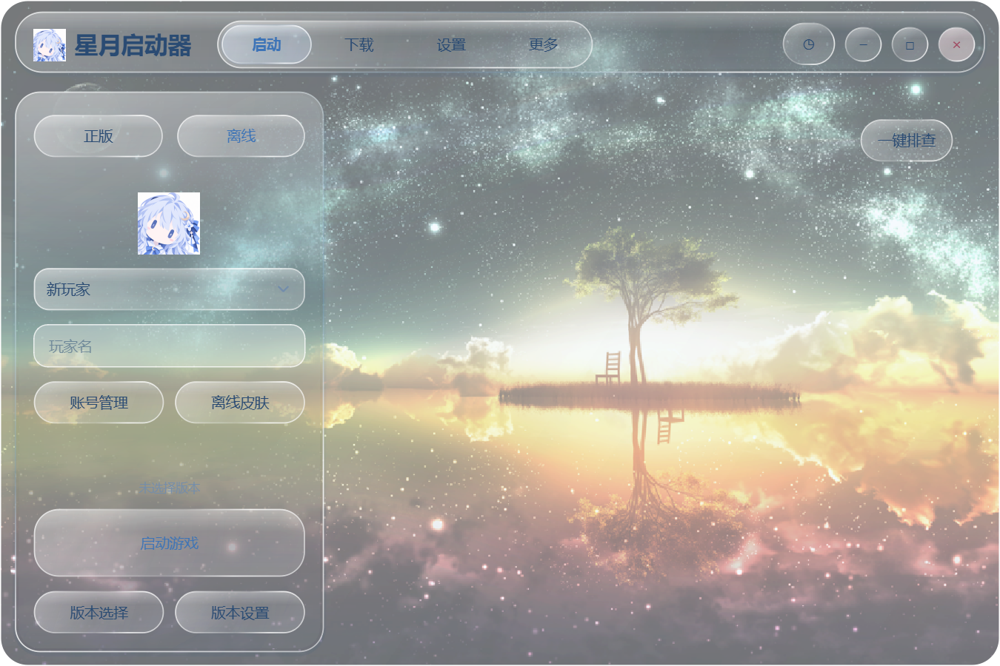

# 星月启动器

[English](README.en.md)

由 **星月晓梦** 制作的 Windows Minecraft Java 版第三方启动器。使用 Python / PySide6 构建，提供原生无边框液态玻璃界面，可打包为单个 EXE。当前版本 **0.7.8**。

[下载 Windows 64 位单文件版](https://github.com/XYXM07/StarMoonLauncher/releases/download/v0.7.8/StarMoonLauncher-0.7.8-windows-x64.exe) · [GitHub Releases](https://github.com/XYXM07/StarMoonLauncher/releases)

下载 EXE 后直接双击运行，无需安装 Python 或自行编译。



## 功能

- 新增模组批量管理、整合包原地升级与回滚、依赖树及前置修复、Java 管理中心和日志/问题报告中心。[使用说明](docs/MANAGEMENT.md)

- 新增模组批量管理、整合包原地升级与回滚、依赖树及前置修复、Java 管理中心和日志/问题报告中心。[使用说明](docs/MANAGEMENT.md)

- 离线账号、Windows Web Account Manager 微软登录。
- 账号列表、登录与皮肤操作统一位于「设置 → 账号管理」；启动页保留快捷入口。
- 游戏安装与启动、Forge / NeoForge / Fabric / Quilt、同版本和不同版本多开。
- 新增 OptiFine / Cleanroom / LiteLoader、数据包与地图下载、自定义游戏标题、截图查看和可选内容/格式/目录的整合包导出。[使用说明](docs/INSTANCE_FEATURES.md)
- PCL 式版本管理，直接添加已有 `.minecraft`，管理模组、存档与版本参数。
- 扫描本机或指定目录下的 `.minecraft`，勾选后批量添加；扫描可随时停止。
- 官方源 / BMCLAPI 镜像、分段下载、任务进度和速度显示。
- Modrinth / CurseForge 内容检索、模组与整合包下载；CurseForge 需要自行配置 API Key。
- 新增 Faithful 资源包来源：浏览 Java 版 32x / 64x 与 Classic / Jappa 系列，选择兼容版本并直接安装，无需 API Key。
- 版本高级启动设置支持 Vulkan（Zink）/ DirectX 12（Mesa D3D12）/ 软件渲染，并可分别控制默认 JVM 参数、启动文件校验、Java 版本检查和本地库自动适配。
- 版本高级启动设置支持 Vulkan（Zink）/ DirectX 12（Mesa D3D12）/ 软件渲染，并可分别控制默认 JVM 参数、启动文件校验、Java 版本检查和本地库自动适配。
- ATLauncher / FTB 整合包浏览与安装、MC 百科中文检索及原站入口、GitHub Releases 模组安装。[内容来源说明](docs/CONTENT_SOURCES.md)
- 可选的 AI 模组名称搜索，以及默认开启的整合包模组补下载。优先从 MC百科相关链接定位项目；补下载前先确认，再由玩家选择候选版本。两个独立开关位于「设置 → 智能排查」，共用已配置的模型接口。
- 本地整合包可直接拖入主窗口安装，支持多文件队列。安装失败弹窗说明原因，并清理本次新建实例和临时文件；保留原始整合包、已有游戏与存档。
- 七种界面配色、动效、可调玻璃效果、自定义壁纸与六张预设壁纸。
- 简体中文 / English 切换，位于「设置 → 外观 → 语言 / Language」，即时生效并自动保存。
- 从 GitHub Releases 检查和下载正式更新，校验后原位替换 EXE 并重启；游戏或任务运行时暂缓安装。[更新说明](docs/UPDATING.md)
- 离线皮肤自定义、公开正版玩家皮肤预览与 PNG 下载。
- 正版账号自动显示皮肤头像；模组管理显示包内图标，缺少时尝试下载平台封面，并展示模组简介。
- 模组管理支持「全部 / 已启用 / 已禁用」分类，可与搜索组合使用；大量模组按滚动位置创建可见卡片，避免切换时重建整页；无图片时显示铺满区域的圆角占位图。
- 模组管理提供「查看网站」，支持元数据中的主页、GitHub / Modrinth / CurseForge 页面和 MC百科；缺少百科直链时可按模组名称搜索。
- 自动内存分配、可选模型崩溃分析和启动前模组排查。


## 使用

运行 `StarMoonLauncher-0.7.8-windows-x64.exe`。首次打开不会自动创建游戏目录；在「启动 → 版本选择」中选择「创建 .minecraft 文件夹」或「添加 .minecraft 文件夹」。下载游戏后选择版本与账号，再启动。

在版本选择左侧点击「扫描 .minecraft 文件夹」：默认递归扫描本机硬盘和可移动磁盘，也可指定扫描目录。扫描结果显示路径、版本数和已添加状态，勾选后批量添加；停止扫描会保留已找到的结果。无权限目录和目录链接会跳过，游戏文件继续保留在原位置。

发布者已确认正版登录应用审核通过。登录使用 Windows Web Account Manager，玩家仍需拥有 Minecraft Java 版及可用的 Xbox 档案。失败时会显示具体授权阶段与错误码。

账号、设置、缓存和运行时保存在 EXE 同目录的 `data/`，兼容旧 `BlockCraft/data/`。移动便携目录时一起保留数据。已有启动器使用同一数据目录时，新进程会唤起旧窗口；更新前先完全退出旧版。

模型分析在「设置 → 智能排查」配置兼容接口、模型与 API Key。分析会向所配置的服务发送相关模组信息或错误日志，密钥使用 Windows DPAPI 加密保存；结果只提供原因和建议。模组静态排查无法发现全部运行期冲突。

## 从源码运行

Windows x64，开发与 CI 配置使用 Python 3.11：

```powershell
py -3.11 -m venv .venv
.\.venv\Scripts\python.exe -m pip install -r requirements-dev.txt
.\.venv\Scripts\python.exe main.py
```

构建单文件 EXE：

```powershell
.\.venv\Scripts\python.exe build.py --output-name StarMoonLauncher-0.7.8-windows-x64
```

运行回归测试：

```powershell
.\.venv\Scripts\python.exe -m unittest discover -s tests -v
```

更多说明：[开发与构建](docs/DEVELOPMENT.md) · [测试与验收](docs/TESTING.md) · [上传 GitHub](docs/GITHUB.md)。

## 源码目录

```text
launcher/          启动器业务、原生界面与控件
assets/            图标、壁纸与离线皮肤代理
licenses/          第三方组件许可
tests/             回归测试和可选验收脚本
scripts/           源码包导出工具
docs/              文档与界面截图
.github/           Windows CI 和反馈模板
main.py            程序入口
build.py           单文件构建
requirements*.txt  运行和开发依赖
publisher.json     公开的微软应用 ID
```

源码导出：`python scripts/export_source.py`。`release-source/` 中只生成当前版本的源码目录和 ZIP，包含源码、构建必需资源、测试与文档。

## 作者与许可

作者：**星月晓梦**。本项目尚未指定自身源码与图片素材的开源许可证；第三方组件许可见 [licenses/NOTICE.txt](licenses/NOTICE.txt)。本项目与 Mojang、Microsoft 没有官方关联。
